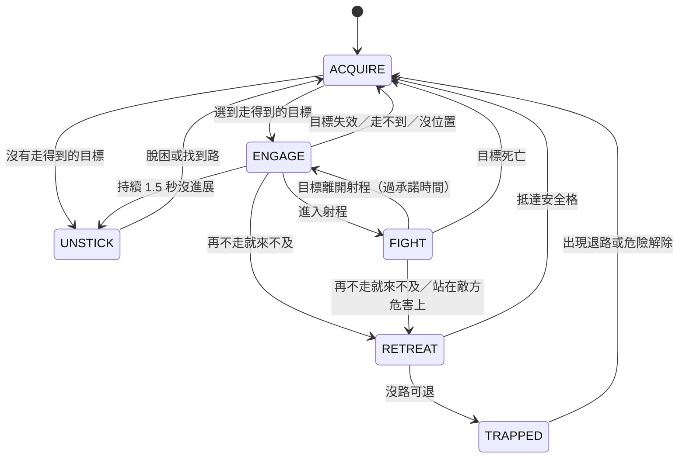

# AI 行為與大逃殺平衡設計（2026-11-02 草案）

> 量測工具：`npm run balance:idle -- --scenario=… --battles=200 --seed=21 [--loadout=…] [--hpScale=…]`。以下數字都用職業血量、seed 21、各 200 場。AI 還沒改；本檔是提案，定案與理由之後移到 `docs/DECISIONS.md`。

## 1. 量測基準

| 場景 | 平均時長 | ≥1 秒發呆／場 | ≥3 秒發呆／場 | 發呆佔存活（坦克／戰士／遠程） | 繞圈佔存活（近戰） |
| :-- | :-- | :-- | :-- | :-- | :-- |
| 全坦克大逃殺（修正前面板實際看到的） | 55 秒 | 9.73 | 1.71 | 7.4% | 1.7% |
| 大逃殺（五職業各 2） | 34 秒 | 1.72 | 0.36 | 6.8%／4.2%／0.5% | 2% |
| 雙陣營標準 | 20 秒 | 1.18 | 0.21 | 6.0%／3.8%／0.6% | 2.3% |
| 全戰士 5v5 | 15 秒 | 0.39 | 0 | —／2.2%／— | 4.5% |

- 全坦克的 342 段 ≥3 秒發呆：高低差 161、路上擠住 122、行為樹落到 Idle 38。最長一段坦克開局就站了 30 秒（第 23 場）。
- 路徑重算每人每秒 1.6～3.3 次；近戰每分鐘換目標 7～10 次。
- 終局（≤19 格）：全坦克進入 175 場，只有 129 場到背水一戰；此階段攻擊 62%、逃跑 23%、發呆 5%；全部死亡的 27% 是掉出地圖。

## 2. 根因（對照程式）

**發呆**
1. 走不到：坦克跳躍力 2，`Pathfinder.findPath` 的 `canStepUp` 擋住後路徑為空；`Reposition` 只看半徑 3 內「更靠近」的格，找不到就落到 `Idle`。站在低窪地的單位可能整場不動。
2. 鄰格差一層打不到：`isMeleeAttackCell`（R6 規則 A）。兩人貼著卻都不能出手。
3. 路上擠住：`MovementSystem.moveAgentToHex` 等佔位者，`stuckTicks` 超過才放棄。

**繞圈**
1. 重挑攻擊格沒有遲滯：`isAttackCellStillValid` 只要路徑下一格被佔就重算，每個 AI tick（60～100 ms）都可能換格。
2. 距離主導選目標：`distScore = 2000/(d+0.5)`，d 從 2 到 1 差 533 分，大於黏著分 300，有人走近就換目標；大家互相追時就繞起來。

**擠中間**
1. 一預警就跑：`Survival` 優先於戰鬥、不看 `shrinkTimer`，預警期整段（10 秒）都不打；`SkillReady` 也禁止在警告格普攻。遠程約 4% 存活時間花在「還有 3 秒以上就在逃」。
2. 目的地偏中心：`findPathToSafety` 目標是 `currentShrink + 2` 層，啟發式再加向心偏好，不是最近的安全格，所以每一波都往中間擠。

**背水一戰太晚**
`ZoneSystem.ts:134` 只在剩下剛好 1 格時觸發。在那之前沒有任何終局規則，只有越來越少的格子和搶位。

## 3. AI 提案（依序，各自能單獨驗收）

> 實作架構見第 9 節（狀態拓樸＋小樹）；這裡的 P0～P3 是行為目標，對應到各狀態。

| 包 | 內容 | 驗收（同 seed 重跑） |
| :-- | :-- | :-- |
| **P0 不准發呆** | ① 可達性：地圖變動時算各跳躍力的連通區；開局只放在主連通區；選目標直接跳過走不到的。② `Idle` 改成「前進」：還有敵人就走到可達區內離敵人最近的格。③ 脫困：連續 1.5 秒沒路時強制跳一次（無視 `canStepUp`）。④ 高低差 ≤ 自己跳躍力時近戰可互打（**推翻 R6 規則 A，要使用者同意**）。 | 全坦克 ≥3 秒發呆 ≤0.1／場（現 1.71）；≥1 秒 ≤1（現 9.73） |
| **P1 不准繞圈** | ① 順手打：普攻射程內有任何敵人就先打，不為了原目標走開。② 目標承諾（業界作法：換目標的分數差門檻＋最短承諾時間，兩者都要）：新目標要明顯勝過現目標才換，追擊中至少 2 秒不換；例外只有目標死亡、走不到、或沒有位置可打（TFT 也是沒位置才換）。被控場後不重選（TFT 18.1 拿掉了這個行為）。③ 攻擊格認領：每個目標的鄰格當槽位，認領「離自己方位最近」的空格並持有，別人不搶，不再每步重挑；搶不到的不站著，改走外一圈或換目標。④ 一步預約：同一格只准一人走入，對向互換要處理（單純預約表擋不住交叉）。每人重算間隔 ≥0.25 秒。 | 全戰士 5v5 繞圈 ≤1.5%（現 4.5%）；路徑重算 ≤1 次／秒 |
| **P2 縮圈行為** | ① 依時間撤退：剩餘時間 ≤ 走到安全格的時間＋1 秒才逃，之前照打。② 撤到最近的安全格，拿掉 `+2` 層與向心偏好。③ 目的地預約，不搶同一格。 | 過早逃離 ≤0.5%；終局攻擊 ≥80%；掉落死亡減半 |
| **P3 背水一戰提早** | 觸發改成「安全格數 ≤ 存活人數，或存活 ≤3 且 ≤7 格」：其餘格一起塌陷，全員拉到中心格，沿用現有規則（禁治療、穿透）。再加逐秒累積的加時：傷害上升、治療與護盾下降，控場時間縮短（TFT 為了解僵局就是這樣做，每秒 10%、減益上限 70%）；數值另外調。TFT 的做法是打到一定秒數就觸發，可以當成第二個觸發條件。 | 終局 ≤10 秒內結束；不再有擠格等待 |

## 4. 職業與技能分析

| 職業 | 血量 | 定位 | 藍（獅心）傾向 | 紅（灰燼）傾向 |
| :-- | :-- | :-- | :-- | :-- |
| 坦克 | 2200 | 前排、控場 | 控制、範圍護盾、強制嘲諷 | 自身續航（吸血、護盾）、鉤人、單點處決 |
| 戰士 | 1350 | 突進、貼身輸出 | 暈眩、聖擊 | 吸血、處決、自我強化 |
| 遊俠 | 800 | 遠程單點 | 控場、多段箭雨 | 持續傷害、超高單發 |
| 法師 | 550 | 遠程範圍爆發 | 範圍與控場，單發較低 | 單發更高、普攻也更高 |
| 輔助 | 900 | 治療、護盾 | 治療、無敵、護盾 | 以血換血、詛咒 |

- 兩陣營是刻意不對稱的團隊設計（藍靠控場與隊友，紅靠單點與自保），放進大逃殺就失衡：藍法師 8 勝、紅法師 41 勝；紅坦克 49、藍坦克 25。
- 給隊友用的技能在大逃殺幾乎沒用：輔助 10 招大招只有 2 招造成傷害；坦克 10 招有 5 招不造成傷害。

**混用插槽實驗（大逃殺，五職業各 2 人，平均應為 20%）**

| 血量差 | 技能 | 坦克 | 戰士 | 遊俠 | 法師 | 輔助 |
| :-- | :-- | :-- | :-- | :-- | :-- | :-- |
| 職業血量 | 照職業 | 37 | 8.5 | 17 | 24.5 | 12.5 |
| 職業血量 | 混大招、主動 | 48.5 | 15.5 | 14 | 12 | 9.5 |
| 職業血量 | 三格全混 | 54.5 | 25.5 | 6 | 5.5 | 8.5 |
| 差距減半 | 照職業 | 25.5 | 8.5 | 18.5 | 27 | 20.5 |
| **差距減半** | **混大招、主動** | **26.5** | **13.5** | **22** | **18** | **20** |
| 差距減半 | 三格全混 | 44 | 20.5 | 14 | 11.5 | 9 |
| 全部同血 | 混大招、主動 | 9 | 15 | 24 | 33.5 | 17 |
| 全部同血 | 三格全混 | 25 | 21.5 | 14.5 | 24.5 | 14 |

- 插槽技術上可混用：400 場無錯誤。**但只混技能會更不平均**：坦克拿到法師的大招、血量又是 4 倍。
- 最接近平均的是「血量差距減半＋只混大招與主動」。普攻留給職業：它決定近戰或遠程，也對應武器造型；全混後坦克能遠程又血厚。
- 混用後藍紅技能的勝率差不多（三格全混、同血那組：9.9% 對 10.0%），陣營不對稱的問題有機會一起解決；建議方案那組還要再統計。

## 5. 大逃殺規則提案（等 AI 改完再定）
1. 陣營數 ≥3 時套用：血量差距減半（`hpScale 0.5`）＋大招、主動從全職業抽，普攻照職業。雙陣營完全不動。
2. 技能池排除「大逃殺沒有效果」的招（只能給隊友用的治療、增益），抽到禁用招就補別的（Dota 2 技能選秀也是限制名單＋補一招）。實驗還沒排除，排除後要重量。
3. 目標：每職業 10～30%。戰士目前最低（13.5%），P0、P1 會改善近戰，要重量才知道。

## 6. 順序
AI 會改變所有平衡數字，所以先 P0→P1→P2→P3，再做第 5 節。規格要跨檔判斷，派 agy 的 Sonnet 5.5（Claude 池 99%）或主代理；每包獨立分支、同 seed 重跑驗收。動到位置與高度的部分先對照 `RenderSpec.ts`。

## 7. 參考資料（2026-11-02 查）
- **有直接用上**：目標遲滯與承諾時間（[Utility AI Enemy Kit](https://studionightfall.itch.io/utility-ai-enemy-kit-for-unity)、[Utility Intelligence 動量加成](https://uintel-go.utilityworlds.com/Documentation/UtilityIntelligence/Decisions/)、[threat table 黏著分](https://www.strayspark.studio/blog/ai-threat-tables-target-selection-ue5)）；攻擊槽位與沒有槽位的不准發呆（[Attack Tokens 文章](https://www.strayspark.studio/blog/attack-token-system-ue5-group-combat-that-feels-fair)，[DOOM 的 token 概念](https://www.gamedeveloper.com/design/cyber-demons-the-ai-of-doom-2016-)）；預約表與交叉限制（[Silver, Cooperative Pathfinding](https://cdn.aaai.org/ojs/18726/18726-52-22369-1-10-20210928.pdf)，只看到摘要）；加時（[TFT wiki](https://wiki.leagueoflegends.com/en-us/Teamfight_Tactics_(game))）；控場後不重選（[TFT 18.1](https://teamfighttactics.leagueoflegends.com/en-us/news/game-updates/teamfight-tactics-patch-18-1/)）；限制名單（[Liquipedia Ability Draft](https://liquipedia.net/dota2/Ability_Draft)，只看到搜尋摘要）。
- **沒找到**：PUBG、Fortnite 的機器人設計文件；混用技能時坦克太強的公開數據（League 的 Ultimate Spellbook 也沒找到設計說明）。P2 的依時間撤退和最近安全格，以及第 4 節的混用結論，依據仍是本專案的量測與程式碼。

## 8. 行為樹全量檢視（2026-11-02，讀碼）

現在只有一棵樹（`data/ai_profiles.ts`）：`Dead → CC → Survival（Run! → 推拉）→ Combat（目標 → Ult／Active／Basic → 追擊 → Reposition → Idle）`。

| # | 問題 | 位置 | 後果 |
| :-- | :-- | :-- | :-- |
| 1 | 樹沒有記憶：每 60～100 ms 從根重跑，`Selector` 每次從第一個子節點開始 | `engine/behaviorTree.ts`、`game.ts` AI tick | 沒有「正在做某事」，分數一變就改主意 |
| 2 | 條件節點有副作用：`HasTarget`、`FindOptimalTarget` 會改 `target`、`targetHex` | `BTRegistry.ts` | 「只是檢查」就換了目標，難以預測 |
| 3 | `targetHex` 一欄三用：逃生目的地、AOE 落點、靠近隊友的格 | `BTRegistry.ts`、`TargetingSystem.ts` | `EscapeWarning` 看到 `targetHex` 還安全就直接走過去，可能把 AOE 落點當逃生點（讀碼確認，未實測） |
| 4 | `target` 一欄兩用：敵人與治療對象，靠 `_savedCombatTarget`＋`restoreCombatTarget` 還原 | `BTRegistry.ts` | 輔助每分鐘換目標 27～32 次（量測） |
| 5 | 逃生邏輯兩份：`TargetingSystem.updateTarget` 開頭一份、`EscapeWarning` 一份，都會寫 `targetHex` | 同上 | 兩邊互相覆蓋 |
| 6 | 隱形狀態機：`aiState` 看起來是標籤，但 `IsEvading` 讀它決定進不進 Survival，清除點散在好幾處 | `BTRegistry.ts` | 狀態轉換沒有地方看得到 |
| 7 | 決策散在三層：行為樹、選目標、`moveAgentToHex`（擠人時回 RUNNING、卡住回 FAILURE） | `MovementSystem.ts` | 查一個發呆要追三個檔 |
| 8 | 技能分支各自走路：大招、主動、普攻要的射程不同，走路時也不會打手邊的敵人 | `createSkillRoutine` | 走位來回、貼著敵人卻不打；AOE 落點每次重算會讓人來回走（讀碼推論） |
| 9 | 兩個「背水」混在一起：`LAST_STAND_PUSH`（個人逃不掉）和全域背水一戰（剩 1 格）；AI 完全不知道全域那個 | `BTRegistry.ts`、`ZoneSystem.ts` | 終局沒有專屬行為 |
| 10 | 危險判定重複：`IsInWarningZone`、`IsInUrgentDanger` 大半相同，後者有一段重複的死碼 | `BTRegistry.ts` | 改一邊漏一邊 |

## 9. 新架構：狀態拓樸＋每個狀態一棵小樹

單位任何時刻都在拓樸圖的一個節點上。**狀態機決定「現在是哪個模式」，那個模式的小樹決定「這一刻怎麼做」。**轉換全部寫成資料裡的邊，不再藏在節點裡。

另外三條全域邊，任何節點都會觸發：`→ DEAD`、`→ CONTROLLED`（暈眩、放逐、恐懼；結束回原節點，不重選目標）、`→ FINALE`（背水一戰）。

| 狀態 | 小樹做什麼 | 持有的資料 |
| :-- | :-- | :-- |
| `ACQUIRE` | 選目標（跳過走不到的），當幀就離開 | — |
| `ENGAGE` | 手邊有敵人就打；認領攻擊格；走過去 | `combatTarget`、`attackCell` |
| `FIGHT` | Ult > Active > Basic；對隊友的招走 `castTarget`，不動 `combatTarget` | `combatTarget`、`castTarget`、`castHex` |
| `RETREAT` | 走向最近的安全格，有預約；路上被堵才推人 | `escapeHex`、`deadline` |
| `TRAPPED` | 原地打、推人（取代 `LAST_STAND_PUSH`） | `combatTarget` |
| `UNSTICK` | 走到可達區內離敵人最近的格；還是不行就強制跳 | `stuckSince` |
| `CONTROLLED` | 不動，保留原節點與目標 | `resumeState` |
| `FINALE` | 拉到中心、只打不跑、吃加時 | — |
| `DEAD` | 等 | — |

**規則**
- 狀態只有一個寫入者（狀態機）。小樹不能改狀態，只能回報結果；條件節點不准有副作用。
- `target`、`targetHex` 拆開後，施法開始時才寫一份給 `SkillExecutor`、`ProjectileSystem`、`ZoneSystem`（它們目前都讀這兩欄）。
- 邊是資料（`data/ai_profiles.ts`），依優先序檢查；每個狀態可設最短停留時間（遲滯）。
- `tests/` 靜態檢查拓樸：每個節點都到得了、都有出邊、沒有走不出去的環；執行期檢查「停在同一節點且沒有動作 > 1 秒」就算失敗，直接對應發呆指標。
- 檢視器顯示目前節點、最近 10 次轉換與原因，加上目前那棵樹（現有 `TreeNode` 可沿用）。

**和第 3 節的對應**：P0＝`ACQUIRE` 可達性＋`UNSTICK`；P1＝`ENGAGE`／`FIGHT`（承諾、認領、順手打）；P2＝`RETREAT`；P3＝`FINALE`。

## 10. 遷移步驟（每步都能單獨驗收）

| 步 | 內容 | 驗收 |
| :-- | :-- | :-- |
| M1 | 骨架：狀態機包住現有整棵樹（單一節點 `LEGACY`），加轉換紀錄與拓樸測試 | 同 seed 模擬數字**完全相同** |
| M2 | 欄位拆開：`combatTarget`、`castTarget`、`castHex`、`escapeHex`；刪掉 `_savedCombatTarget` 與選目標裡那份逃生邏輯；條件節點去副作用 | 測試全過；第 3 項修掉；其他指標不變差 |
| M3 | 切樹：`DEAD`、`CONTROLLED`、`RETREAT`、`TRAPPED`、`ACQUIRE`、`ENGAGE`、`FIGHT` 各一棵，先搬現有行為 | 指標不變差（容差內） |
| M4～M7 | 依序做 P0、P1、P2、P3，每包達標才進下一包 | 第 3 節的驗收數字 |
| M8 | 大逃殺技能規則（第 5 節），重量勝率 | 每職業 10～30% |

M1～M3 是核心架構，主代理自己做；M4 之後規格清楚的小包可派 agy 的 Sonnet。全部是模擬與 AI，不動渲染；`aiState` 的讀者（導演、狀態視覺、檢視器、`AgentDerived`）在 M3 一起對照。
